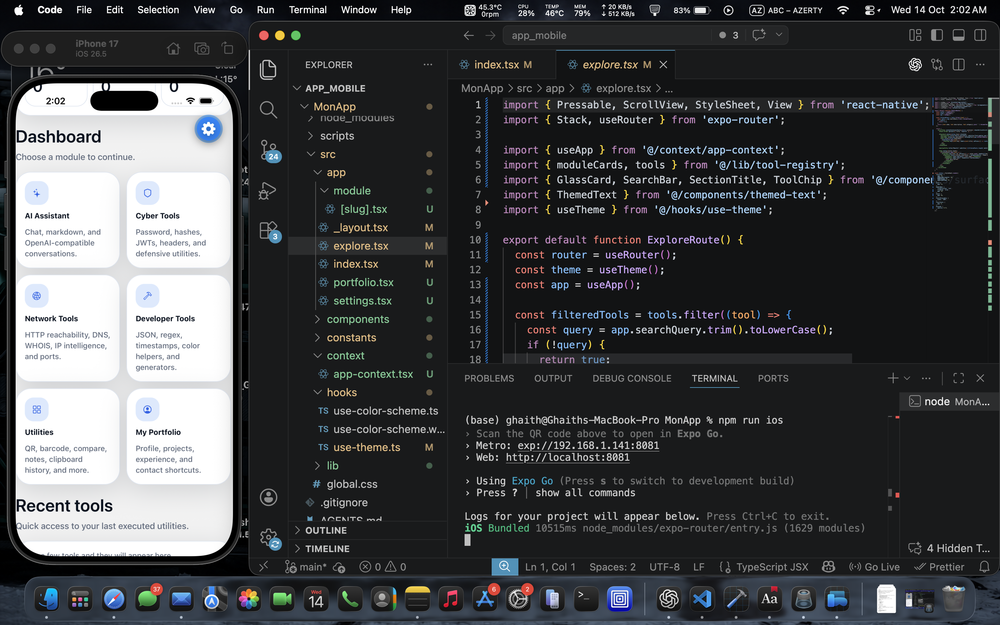

# Nexora

**Nexora** is a cross-platform toolkit that brings together practical
tools for technology, development, network diagnostics, cybersecurity,
and AI-assisted workflows in one application.



> **Status:** In development

## Features

-   A unified interface for accessing different technical tools
-   Network diagnostics utilities
-   Cybersecurity-related utilities
-   Developer productivity tools
-   AI-assisted workflows, where configured
-   Cross-platform app structure

> Feature availability depends on the tools currently implemented in the
> project.

## Tech Stack

-   **React Native**
-   **Expo**
-   **TypeScript**
-   **React**

## Getting Started

### Prerequisites

-   Node.js (LTS recommended)
-   npm
-   Expo Go on a compatible mobile device, or an emulator/simulator

### Installation

``` bash
git clone <YOUR_REPOSITORY_URL>
cd <YOUR_PROJECT_FOLDER>
npm install
```

### Run the application

``` bash
npx expo start
```

Follow the Expo CLI instructions to open the app on a device or
emulator.

## Project Structure

The exact structure may vary as the project evolves. Common areas
include:

-   `app/` --- application screens and routes
-   `components/` --- reusable UI components
-   `assets/` --- images, icons, and other static assets
-   `package.json` --- scripts and dependencies

## Development

1.  Create a feature branch.
2.  Implement and test the change.
3.  Check the app on the intended platforms.
4.  Submit a pull request or merge the change into your main branch.

## Roadmap

-   [ ] Refine the user interface and navigation
-   [ ] Expand the collection of technical tools
-   [ ] Improve validation and error handling
-   [ ] Add tests for core functionality
-   [ ] Document each tool and its limitations

## Security & Responsible Use

Use network and cybersecurity tools only on systems and networks you own
or are explicitly authorized to test. Avoid entering secrets or
sensitive data into untrusted tools.

## Author

**Ghaith Riabi**

-   GitHub: https://github.com/ghaithrb
-   LinkedIn: https://www.linkedin.com/in/riabi-ghaith-2a1b09316
-   Portfolio: https://ghaith-riabi-cyber.netlify.app/

## License

Add the license that applies to this project before distributing it
publicly.
